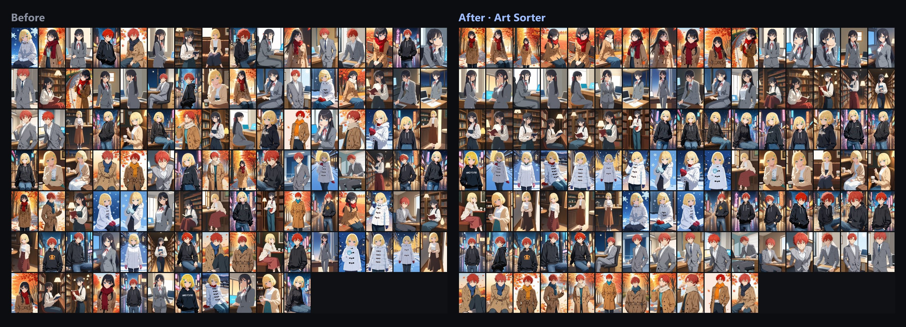
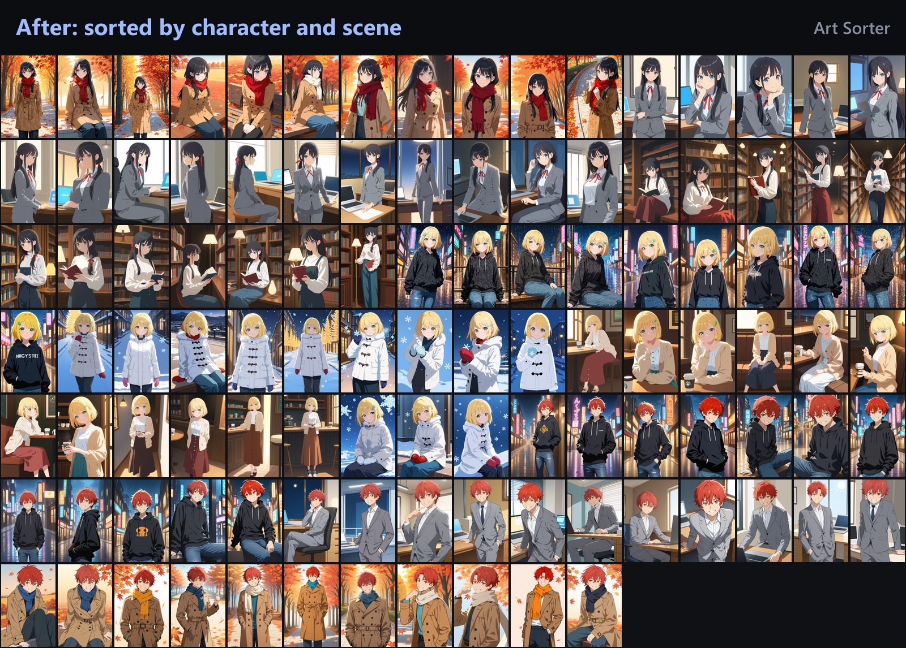

<h1 align="center">Art Sorter</h1>

<b>把成千上万张插画、同人图和 AI 生成图按角色和场景排好的 Windows 软件。全部在你自己的电脑上运行。</b>

<a href="https://orilabs.studio/artsorter/zh/?utm_source=github">官网</a> ·
<a href="https://orilabs.studio/artsorter/zh/get/?utm_source=github">下载 Windows 版</a> ·
<a href="https://orilabs.studio/artsorter/zh/guides/?utm_source=github">指南</a> ·
<a href="README.md">English</a> · <a href="README.ko.md">한국어</a> · <a href="README.ja.md">日本語</a>

把文件夹拖进去，它看的是画面而不是文件名，把图排成一列：同一角色在一起，然后同一场景在一起，再按先后顺序。连尺寸不同的副本也会单独放好。全部在你自己的电脑上运行。

> 这个仓库是说明文档和公开的问题反馈区。Art Sorter 本身是带免费试用的闭源桌面软件。

## 能做什么

- **按角色归组。** 用插画训练的模型，不同日子、不同画师的图，只要是同一角色就归到一起。
- **再按场景和顺序。** 在每个角色内按场景排，再按先后顺序。
- **重复图单独放。** 完全相同的副本，以及缩小、转格式、重新保存过的副本，都放进单独的文件夹，方便对比再决定。什么都不删除。
- **追加不用重排。** 新图插到相似的图旁边，你调整好的顺序保持不变。
- **也看来源。** 如果同一文件夹或同一命名格式的图大多进了同一组，跑散的几张会被拉回来。
- **名字只起一次。** 选中图片输入名字，一起改名。不想被动的组可以固定。
- **一切都能撤销。** 每一步都能撤销，移动过的文件一键回到原来的文件夹。
- **导出标签。** Hydrus 旁车文件、给 digiKam 和 XnView MP 用的 XMP、Eagle、CSV。原文件不会被修改。
- **大收藏也行。** 一次几万张，可以暂停再继续。
- **18 种界面语言。**

实际效果：113 张演示图（3 个角色，各 4 个场景）在笔记本上约两分半排好，最后有 2 张位置不对。

## 适合谁
- 在 **Patreon、FANBOX 或 Fantia** 支持多位画师并把作品全部下载的人：画师文件夹是有了，但每个文件夹里套图、差分和重复下载仍混在一起。
- 用 **Stable Diffusion、NovelAI、Midjourney 或 ComfyUI** 大量生成，想把输出按角色和场景分开的人。
- 从 **X、Pixiv 或 Discord** 保存了成千上万张、文件名杂乱的图片的人。
- 收集**漫画分格、CG 套图和截图**，想按自己定的顺序排列的人。
- 文件夹变成压缩包套压缩包的所有人。

## 隐私

Art Sorter 是桌面软件，不是网络服务。无需注册，也不上传。图片、文件名和文件夹名都不会离开你的电脑。第一次启动时下载一次分析模型之后，断网也能用。

不经询问会联网的只有：检查更新、那一次模型下载、用匿名电脑编号做的授权验证。

## 配置要求

| | |
|---|---|
| 系统 | Windows 10 / 11（64 位） |
| 内存 | 8GB（3 万张以上建议 16GB） |
| 硬盘 | 约 1.5GB。安装包 200MB，分析模型 840MB 首次下载一次 |
| 显卡 | 可选。有支持 DirectX 12 的显卡会自动使用 |

## 价格

- **免费试用会整理整个文件夹**并展示结果；其中 300 张保留原图，其余在购买前为低分辨率预览。原文件不会被移动或修改。无需注册，无需绑卡。
- 也可从 [Microsoft Store](https://apps.microsoft.com/detail/9MSZX5KNTVR0?cid=github) 获取（安装时没有 Windows 警告画面）。
- 之后是**买断**（不是订阅）。一个授权码对应一台电脑，所有更新都包含。
- 当前价格请看[官网价格栏](https://orilabs.studio/artsorter/zh/?utm_source=github#pricing)。

## 指南

- [如何整理成千上万张 AI 生成图](https://orilabs.studio/artsorter/zh/guides/organize-ai-images/?utm_source=github)
- [查找重复图片，连尺寸不同的副本也能找到](https://orilabs.studio/artsorter/zh/guides/find-duplicate-images/?utm_source=github)
- [按角色自动整理动漫图和同人图](https://orilabs.studio/artsorter/zh/guides/sort-by-character/?utm_source=github)
- [Eagle 替代软件](https://orilabs.studio/artsorter/zh/guides/eagle-alternative/?utm_source=github)
- [Hydrus 替代软件](https://orilabs.studio/artsorter/zh/guides/hydrus-alternative/?utm_source=github)
- [整理用 gallery-dl 下载的图片](https://orilabs.studio/artsorter/zh/guides/organize-gallery-dl-downloads/?utm_source=github)
- [整理 Patreon、FANBOX 赞助回报图包](https://orilabs.studio/artsorter/zh/guides/organize-patreon-fanbox-packs/?utm_source=github)
- [整理从 pixiv 保存的插画](https://orilabs.studio/artsorter/zh/guides/organize-pixiv-collection/?utm_source=github)

## 反馈和问题报告

如果你发现某个文件夹排得不对，这就是最有用的反馈。请在[问题反馈](../../issues/new/choose)里写下大概多少张、什么样的图、哪里不对。欢迎附截图，但请只附可以公开的图片。

邮箱：contact@orilabs.studio

---

由韩国的一人工作室 OriLabs Studio（오리랩스）制作。
